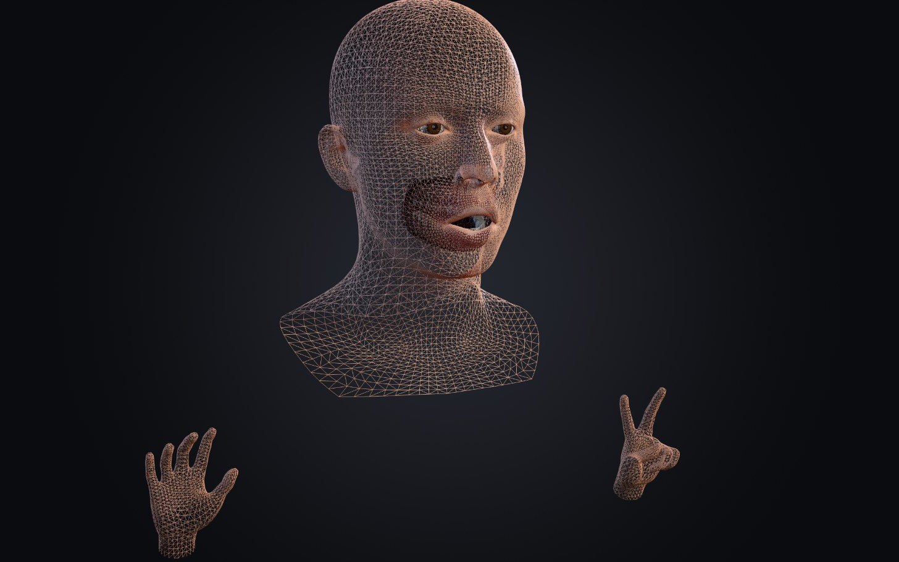
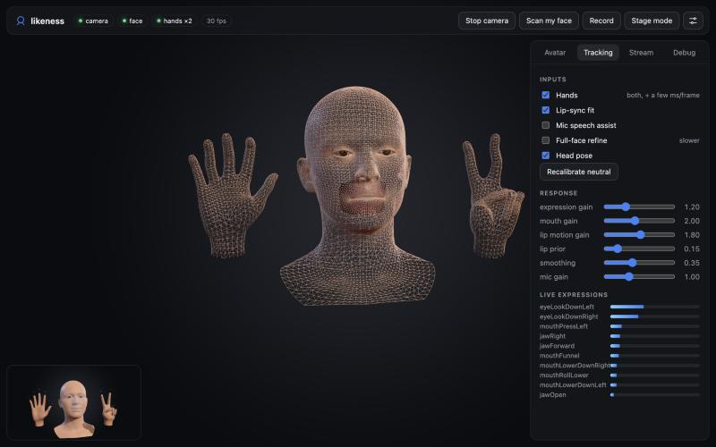
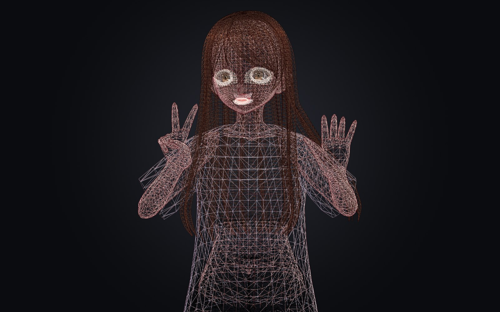
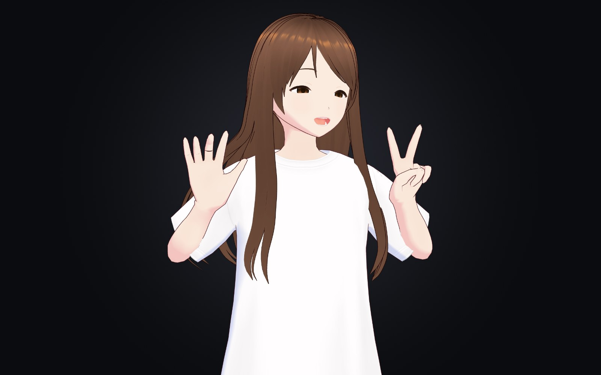
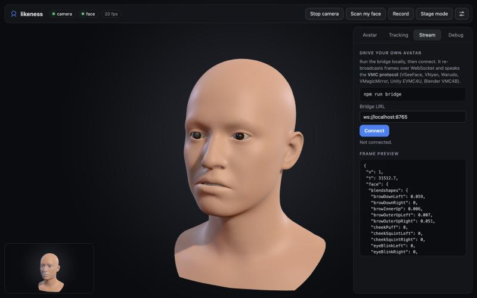
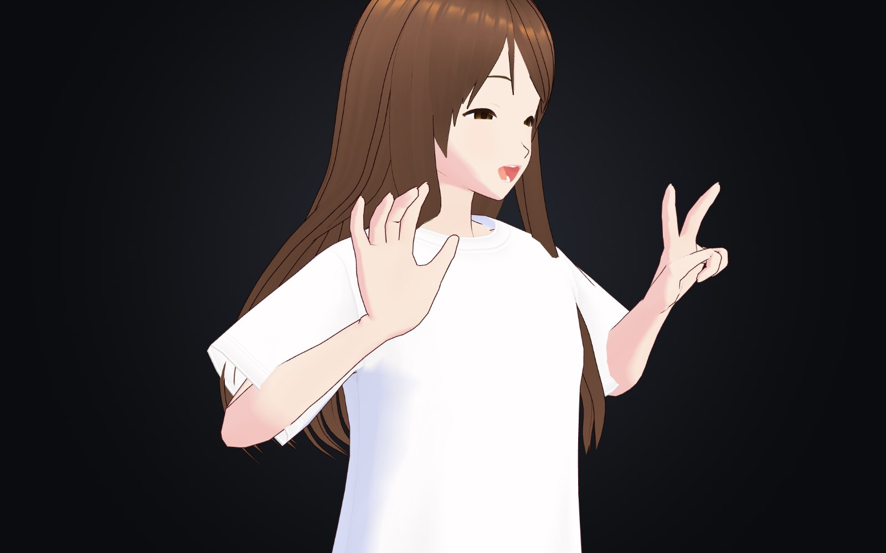
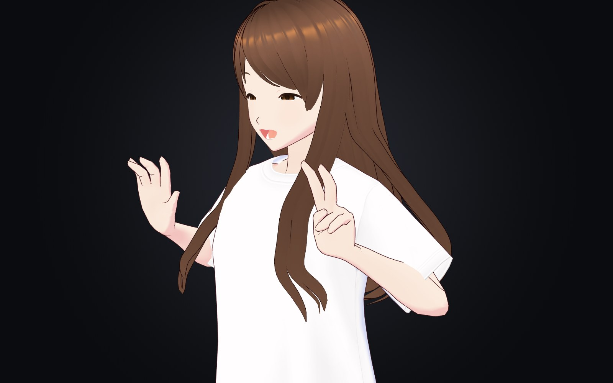
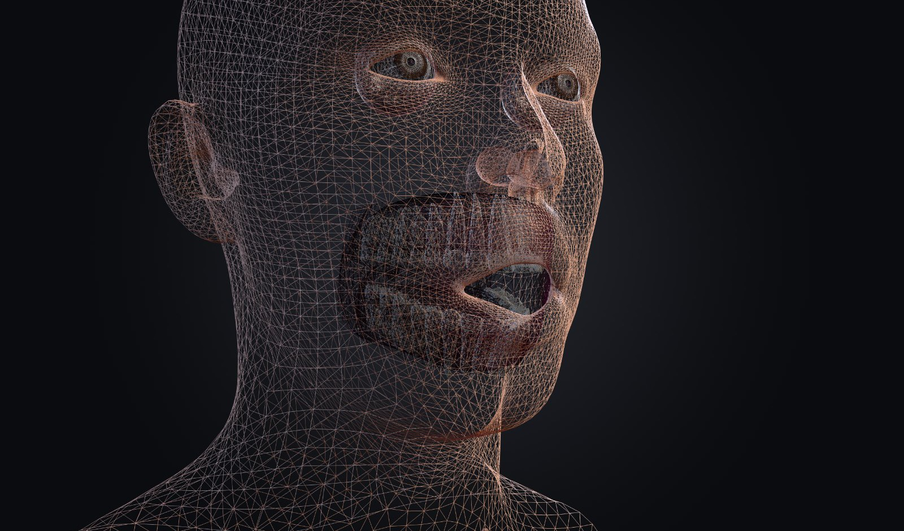

<h1 align="center">likeness</h1>

<p align="center">
  <strong>Real-time face, lip and hand tracking in the browser that drives 3D avatars.</strong><br/>
  Your own VRM, a built-in scannable head, or any VTuber app and game engine over VMC.
</p>

<p align="center">
  <a href="LICENSE"></a>
  
  
  
</p>

<p align="center">
  
</p>

likeness turns a webcam into a motion-capture rig. It tracks the face, lips and both hands with
MediaPipe, refines the result with a morphable face model, and emits a compact, standard frame per video
frame: the 52 ARKit blendshapes, head pose and hand joints in metres. Render it with the built-in avatar,
drive your own VRM, or stream it to VSeeFace, VNyan, Warudo, Unity, Blender or your own code.

Everything runs locally in the page. No video or tracking data leaves the machine.

## Features

- **Face tracking with real lip-sync.** MediaPipe's blendshape scores are refined by a landmark fit
  against the ICT-FaceKit morphable model, so ordinary speech moves the mouth, not only exaggerated faces.
  Optional microphone assist for low-light or low-resolution cameras.
- **Two-hand tracking.** 21 joints per hand, placed in metric camera space with anatomical finger
  constraints, rendered with rigged hands.
- **Standard output.** One `LikenessFrame` per video frame: ARKit 52 blendshapes, head quaternion and
  position, hand joints. Versioned, documented, JSON-friendly.
- **Bring your own avatar.** Drive VRM 0.x and 1.0 models in the page, with perfect-sync when the model
  has ARKit shapes and VRM presets otherwise.
- **Stream anywhere.** A local bridge speaks the VMC protocol (VSeeFace, VNyan, Warudo, VMagicMirror,
  EVMC4U for Unity, VMC4B for Blender) and re-broadcasts JSON over WebSocket.
- **Make it look like you.** A 10-second face scan fits the head shape to your face and bakes a de-lit skin
  texture from the webcam.
- **Small and fast.** Tracking-only builds load about 245 kB of script and no three.js. About 7 ms per
  frame for face tracking and 13 ms with both hands on an Apple M5 Pro.

<p align="center">
  
  
  
  
  
  
</p>
<p align="center">
  
</p>
<p align="center"><sub>
  Mid-word close-up: the tracked jaw and lip shapes open the full mouth interior, teeth and gums included.
  The performer in these shots is the demo app's built-in <em>demo face</em>, an animated synthetic head
  rendered to video and tracked by MediaPipe exactly like a webcam.
</sub></p>

## Quick start

```bash
git clone https://github.com/raincrash/likeness.git
cd likeness
npm install
npm run dev
```

Open http://localhost:5173 and press **Start camera**, or **No camera? Try a demo face**.
Requires Node 16+ and a browser with WebGL and camera access (`https://` or `localhost`).

## Installation

```bash
npm install github:raincrash/likeness three
```

`three` (>= 0.160) is a peer dependency. Installing from Git runs the `prepare` script, which builds
`dist/`. The library loads its data files (face and hand models) at runtime; with a bundler, copy them into
your public folder once:

```bash
cp -r node_modules/likeness/dist/lib/assets public/likeness
```

To serve them elsewhere, or for use without a bundler, see [Hosting](docs/hosting.md).

| Entry point | Contents |
|---|---|
| `likeness/tracking` | `LikenessTracker`, `StreamClient`, frame helpers. No three.js. |
| `likeness` | Everything above plus `LikenessAvatar`, the built-in 3D avatar. |
| `likeness/vrm` | `VrmAvatar` for VRM 0.x / 1.0 models. |
| `likeness/element` | The `<likeness-avatar>` web component. |

## Usage

### Track a face and hands

```ts
import { LikenessTracker } from "likeness/tracking";

const tracker = await LikenessTracker.create({ hands: true });

tracker.on("frame", (frame) => {
  if (!frame.face) return;
  const { jawOpen, eyeBlinkLeft, mouthSmileLeft } = frame.face.blendshapes;
  const [qx, qy, qz, qw] = frame.face.head.rotation;
  for (const hand of frame.hands) console.log(hand.side, hand.joints[8]); // index fingertip
});

await tracker.start(); // default webcam; also accepts a <video> element or MediaStream
```

The first ~1.5 s calibrate the user's neutral face. Call `tracker.calibrate()` to redo it.

### Render the built-in avatar

```ts
import { LikenessTracker, LikenessAvatar } from "likeness";

const tracker = await LikenessTracker.create({ hands: true });
const avatar = await LikenessAvatar.create({ container: document.querySelector("#stage")! });

tracker.on("frame", (frame) => avatar.apply(frame));
await tracker.start();

// Optional: fit the head shape and skin to the user (about 10 s).
await avatar.scanFace(tracker, (p) => console.log(p.message));
```

### Drive your own VRM

```ts
import * as THREE from "three";
import { LikenessTracker, LikenessAvatar } from "likeness";
import { VrmAvatar } from "likeness/vrm";

const tracker = await LikenessTracker.create({ hands: true });
const stage = await LikenessAvatar.create({ container: document.querySelector("#stage")! });
const vrm = await VrmAvatar.load("/models/avatar.vrm"); // URL, File or ArrayBuffer

stage.setCustomAvatar(vrm.scene);                  // replaces the built-in head
vrm.scene.updateMatrixWorld(true);
vrm.scene.position.sub(vrm.getHeadPosition(new THREE.Vector3())); // centre the head in view
stage.onRender((dt) => vrm.update(dt));            // spring bones, look-at, expressions

let last = 0;
tracker.on("frame", (frame) => {
  vrm.apply(frame, last ? (frame.t - last) / 1000 : 1 / 30, { mirror: true });
  last = frame.t;
});
await tracker.start();
```

See [VRM](docs/vrm.md) for the expression mapping, mirroring and MToon lighting.

### Drop in a web component

```html
<!-- dist/standalone/element.js, or `import "likeness/element"` with a bundler -->
<script type="module" src="./likeness/element.js"></script>

<likeness-avatar hands background="transparent" style="width: 640px; height: 480px"></likeness-avatar>
<button id="start">Start camera</button>

<script type="module">
  const avatar = document.querySelector("likeness-avatar");
  document.querySelector("#start").onclick = () => avatar.start(); // camera access needs a user gesture
  avatar.addEventListener("frame", (e) => console.log(e.detail));  // LikenessFrame
</script>
```

Attributes: `hands`, `autostart`, `no-mirror`, `no-lip-sync`, `background`, `stream`, `model-url`, `hands-url`.

### Stream to VTuber apps and engines

```bash
npm run bridge -- --mirror   # WebSocket on ws://localhost:8765, VMC to 127.0.0.1:39539
```

```ts
import { LikenessTracker, StreamClient } from "likeness/tracking";

const tracker = await LikenessTracker.create({ hands: true });
const stream = new StreamClient("ws://localhost:8765");
stream.connect();
tracker.on("frame", (frame) => stream.send(frame));
await tracker.start();
```

Point any VMC receiver at port 39539, or read the JSON stream from any WebSocket client. The
[bridge guide](bridge/README.md) has per-app recipes, every flag and the coordinate conventions.

## Output format

```jsonc
{
  "v": 1,
  "t": 23438.2,                                   // ms, monotonic
  "face": {
    "blendshapes": { "jawOpen": 0.27, "eyeBlinkLeft": 0.83, /* all 52 ARKit names, 0..1 */ },
    "head": { "rotation": [0.03, -0.15, 0.01, 0.99], "position": [0.01, 0.04, -0.58] },
    "calibrated": true
  },
  "hands": [{ "side": "left", "score": 0.97, "joints": [[0.18, -0.12, -0.52] /* 21 joints */] }]
}
```

Right-handed camera frame in metres, unmirrored; `left` and `right` always refer to the subject.
Full conventions: [Frame format](docs/frame-format.md).

## Demo app

`npm run dev` starts a full-featured demo: live tracking with expression readouts, face scan, VRM loading,
recording, streaming, a stage mode for OBS (`?stage&bg=transparent`) and a camera-free demo face.
See [Demo app](docs/demo.md).

## Performance

Apple M5 Pro, Chromium, 1280×720 input. Accuracy is measured against ground truth from a synthetic camera.

| | Face | Face + hands |
|---|---|---|
| Tracking cost per frame (avg / p95) | 7.2 / 10.0 ms | 13.4 / 18.4 ms |
| likeness solver share | 0.1 ms | 0.1 ms |
| Head yaw error | 1.9° median | |
| Blink / smile correlation | 0.98 / 0.93 | |

Methodology, bundle sizes and how to reproduce: [Benchmarks](docs/benchmarks.md).

## How it works

1. **MediaPipe** detects 478 face landmarks, 52 blendshape scores and 21 joints per hand.
2. **Alignment.** The landmarks are embedded on the ICT-FaceKit morphable model; a closed-form rigid fit
   on stable upper-face points gives the head pose.
3. **Calibration and lip fit.** A per-user neutral baseline is removed, then mouth and jaw shapes are solved
   from lip and chin motion with a bounded, per-shape regularised least-squares fit.
4. **Filtering.** One Euro filters smooth a still face without lagging fast speech; hand fingers get
   anatomical joint constraints.
5. **Output.** Weights are mapped to ARKit names and packed, with head and hands, into a `LikenessFrame`.

The face scan adds an identity fit, projective texture baking with spherical-harmonic delighting and a
symmetry fill. Details: [How it works](docs/how-it-works.md) and [Architecture](docs/architecture.md).

## Documentation

| | |
|---|---|
| [API reference](docs/api.md) | Every class, option, method and event |
| [Frame format](docs/frame-format.md) | `LikenessFrame` fields and coordinate conventions |
| [Streaming bridge](bridge/README.md) | VMC and WebSocket output, app recipes, flags |
| [VRM](docs/vrm.md) | Expression mapping, mirroring, lighting, limitations |
| [Hosting](docs/hosting.md) | Data files, standalone builds, self-hosting MediaPipe |
| [How it works](docs/how-it-works.md) | Methods: fitting, filtering, face scan, rendering |
| [Architecture](docs/architecture.md) | Pipeline diagram and module map |
| [Benchmarks](docs/benchmarks.md) | Speed, accuracy and sizes |
| [Development](docs/development.md) | Repository layout, tests, regenerating the model |

## Limitations

- Head and hand depth assume a 65° horizontal field of view (configurable); rotations and expressions do not.
- One face at a time. `tongueOut` is not tracked.
- The face scan captures skin shape and colour; hair, glasses and eye colour are not captured.
- VMC output is protocol-tested but not yet verified inside every receiving app; VRM 0.x is unit-tested,
  VRM 1.0 is verified visually.
- Developed and measured in Chromium.

## Contributing

Issues and pull requests are welcome. Run `npm test` and `npm run build:lib` before submitting; see
[Development](docs/development.md).

## License

likeness is released under the [MIT License](LICENSE).

Third-party assets keep their own licences:

- **Face model** (`public/ict/`): derived from [ICT-FaceKit](https://github.com/ICT-VGL/ICT-FaceKit), MIT,
  © 2020 USC Institute for Creative Technologies.
- **Hand models** (`public/hands/`): WebXR Input Profiles generic hands, MIT, © 2019 Amazon.
- **Sample VRM** (`public/avatars/`, demo only, not part of the package): © 2022 pixiv Inc.,
  [VRM Public License 1.0](https://vrm.dev/licenses/1.0/).
- **MediaPipe** (`@mediapipe/tasks-vision`, canonical face mesh): Apache-2.0. The MediaPipe runtime and
  models are fetched at runtime from jsDelivr and Google by default and can be self-hosted.
