# Architecture

likeness has one contract in the middle, the `LikenessFrame` (`src/frame.ts`). Everything left of it turns
video into frames; everything right of it turns frames into a moving avatar, in the page or elsewhere.

## Pipeline

```mermaid
flowchart LR
  subgraph browser["Browser (all local)"]
    direction LR
    cam["Webcam, video file<br/>or MediaStream"]
    mic["Microphone<br/>(optional)"]
    mpf["MediaPipe Face Landmarker<br/>478 landmarks + 52 scores"]
    mph["MediaPipe Hand Landmarker<br/>2 x 21 joints (optional)"]
    lm[("ict-landmarks.*<br/>landmark model")]

    subgraph driver["FaceDriver (src/driver.ts)"]
      direction TB
      prior["Scores minus neutral baseline,<br/>gains"]
      align["Rigid alignment<br/>(Horn, upper-face points)"]
      calib["Neutral calibration<br/>(45 frames)"]
      lip["Lip-sync fit<br/>(Jacobi-scaled bounded ridge)"]
      assist["Mic speech assist"]
      euro["One Euro filter"]
      prior --> lip
      align --> calib --> lip --> assist --> euro
    end

    hf["HandFilterBank<br/>(perspective placement,<br/>One Euro)"]
    fb["frameBuilder<br/>ictToArkit, headPose"]
    frame{{"LikenessFrame<br/>52 ARKit + head + hands"}}

    avatar["LikenessAvatar<br/>ICT head + hands"]
    vrm["VrmAvatar<br/>your VRM"]
    sc["StreamClient<br/>(WebSocket, drops not queues)"]
    app["Your code<br/>tracker.on('frame')"]

    cam --> mpf & mph
    mic --> assist
    lm --> driver
    mpf --> prior
    mpf --> align
    mph --> hf
    euro --> fb
    hf --> fb
    fb --> frame
    frame --> avatar & vrm & sc & app
  end

  subgraph bridgeSG["likeness-bridge (local Node)"]
    direction TB
    val["Validate, pick source"]
    json["Re-broadcast JSON"]
    vmc["VMC encoder<br/>(OSC bundles)"]
    val --> json & vmc
  end

  sc -- "ws://localhost:8765" --> val
  json -- "WebSocket JSON" --> clients["Python, Unity, Unreal,<br/>Godot, JS clients"]
  json -- "log flag" --> stdout["stdout, JSON lines"]
  vmc -- "UDP 39539" --> apps["VSeeFace, VNyan, Warudo,<br/>VMagicMirror, EVMC4U, VMC4B"]
```

The face scan is a side path: `LikenessAvatar.scanFace(tracker)` reads the tracker's video and
`lastProjection` (the camera-to-model similarity) every frame, calls `tracker.fitIdentity()` after a fresh
calibration, and bakes the video into the head's UV texture with `TextureBaker` (`src/bake.ts`).

## One frame, step by step

1. `LikenessTracker` (`src/tracking.ts`) gets a new video frame through `requestVideoFrameCallback`
   (falling back to `requestAnimationFrame`). By default MediaPipe runs in two Web Workers
   (`src/detectWorker.ts`, driven by `src/detectClient.ts`), one per task: the tracker wraps the frame in a
   `VideoFrame` (GPU-backed, no copy), transfers it to the face worker and a clone to the hand worker, and
   both detect in parallel while the main thread keeps rendering. A frame that arrives while the previous one
   is still in flight waits and is picked up as soon as it's done, so latency never queues up. Without
   worker support (or with `worker: false`) the same detectors run on the main thread, one after the other,
   and MediaPipe's JS is only loaded then.
2. `FaceTracker` (`src/tracker.ts`) runs MediaPipe's face landmarker: 478 landmarks, converted to centred
   pixel coordinates (x right, y up, z towards the camera), plus 52 blendshape scores. Only these arrays
   cross back from the worker.
3. `FaceDriver.update` (`src/driver.ts`):
   - turns scores into prior weights relative to the calibrated neutral, with gains;
   - aligns the observed landmarks to the landmark model on 21 rigid upper-face points (`similarity` in
     `src/solver.ts`), which gives the head rotation and scale;
   - during the first 45 face frames, accumulates the neutral baseline and neutral landmark shape;
   - re-solves the mouth and jaw weights from lip and chin motion (`BoundedRidge`);
   - optionally raises jaw and lower-lip weights from the microphone envelope (`SpeechMeter`, `src/audio.ts`);
   - filters all weights with a One Euro filter.
4. If hands are on, `HandTracker` (`src/handTracker.ts`) runs MediaPipe's hand landmarker on the same frame
   and timestamp, and `HandFilterBank` (`src/handFilter.ts`) places each hand in the camera frame
   (`estimatePalm` in `src/handMath.ts`) and smooths it. With no hand in view for 15 frames, the tracker
   looks for new hands (MediaPipe's palm detector, the costly part) only every third frame, and goes back to
   every frame as soon as one appears.
5. `frameBuilder` (`src/frameBuilder.ts`) converts ICT weights to the 52 ARKit names (`ictToArkit`), turns the
   similarity into a head quaternion and position (`headPose`, pinhole with the assumed FOV) and assembles the
   frame.
6. The tracker emits `frame`. Consumers:
   - `LikenessAvatar.apply` (`src/avatar.ts`) maps ARKit names back to ICT expressions, evaluates the sparse
     blendshapes on the CPU straight into the render buffers (`IctModel.evaluateRender`, skipping expressions
     under 0.001) and updates the mesh, head pivot and `HandRig` (`src/hands.ts`);
   - `VrmAvatar.apply` (`src/vrm.ts`) maps ARKit to perfect-sync or VRM preset expressions
     (`src/vrmMapping.ts`), splits the head rotation between neck and head, sets gaze, and solves arms and
     fingers;
   - `StreamClient.send` (`src/stream.ts`) rounds and sends the JSON to the bridge, or drops it;
   - your own listeners.
7. `likeness-bridge` (`bridge/likeness-bridge.mjs`) validates the frame (`bridge/vmc.mjs`), re-broadcasts it to
   all other WebSocket clients, and converts it to VMC messages (`frameToVmc`), encoded as OSC bundles
   (`bridge/osc.mjs`) and sent over UDP.

## Module map

| Module | Role | Depends on |
|---|---|---|
| `src/lib.ts` | `likeness` entry: tracking, avatar, streaming, assets | `index.ts`, `avatar.ts`, `stream.ts`, `assets.ts` |
| `src/lib-element.ts`, `src/lib-vrm.ts` | `likeness/element`, `likeness/vrm` entries | `element.ts`, `vrm.ts` |
| `src/lib-assets.ts` | Library builds only: default asset base = `assets/` next to the bundle | `assets.ts` |
| `src/index.ts` | Tracking exports (no render mesh) | |
| `src/frame.ts` | `LikenessFrame` types, `ARKIT_BLENDSHAPES`, `HAND_JOINTS`, `ictToArkit` | |
| `src/frameBuilder.ts` | Frame assembly, `headPose`, `matToQuat` (pure, Node-testable) | `frame.ts` |
| `src/tracking.ts` | `LikenessTracker`: loop, events, calibration, hands, mic | `tracker.ts`, `handTracker.ts`, `driver.ts`, `handFilter.ts`, `audio.ts` |
| `src/tracker.ts` | MediaPipe face landmarker wrapper, default CDN URLs, rigid landmark set | `@mediapipe/tasks-vision` |
| `src/handTracker.ts` | MediaPipe hand landmarker wrapper | `@mediapipe/tasks-vision`, `handMath.ts` |
| `src/driver.ts` | `FaceDriver`: scores, alignment, calibration, lip fit, identity fit, filtering | `solver.ts`, `landmarkModel.ts` |
| `src/solver.ts` | `similarity` (Horn), `LinearFitter`, `BoundedRidge`, `OneEuro` | |
| `src/landmarkModel.ts` | Landmark-only face model (`ict-landmarks.*`) | |
| `src/ict.ts` | Full ICT render model (`ict.*`): sparse evaluation, normals, landmark sampling | |
| `src/handMath.ts` | Hand geometry: perspective placement, palm frames, WebXR joint mapping | |
| `src/handFilter.ts` | Per-hand smoothing (One Euro on depth, palm position and shape); resets a hand unseen for 0.3 s | `solver.ts`, `handMath.ts` |
| `src/hands.ts` | `HandRig`: rigged WebXR hand models for `LikenessAvatar` | three.js, `handMath.ts` |
| `src/avatar.ts` | `LikenessAvatar`: scene, head mesh, hands, scan, snapshot | three.js, `ict.ts`, `look.ts`, `bake.ts`, `hands.ts` |
| `src/look.ts`, `src/skin.ts` | Lights, environment, materials; skin, cavity and eye shader patches | three.js |
| `src/bake.ts` | `TextureBaker`: projective capture, depth prepass, delighting, symmetry fill | three.js, `sh.ts`, `bakecpu.ts` |
| `src/bakecpu.ts` | CPU side of the bake: light samples, mirror map, skin tone, feathered fill | |
| `src/sh.ts` | Second-order SH basis, robust shading fit, exposure normalisation | |
| `src/vrm.ts` | `VrmAvatar`: loading, expressions, head, gaze, arm IK, fingers | three.js, `@pixiv/three-vrm`, `vrmMapping.ts` |
| `src/vrmMapping.ts` | Pure ARKit to VRM mapping (presets, perfect sync, mirroring, gaze) | `frame.ts` |
| `src/stream.ts` | `StreamClient`: rate cap, backpressure, reconnects | |
| `src/element.ts` | `<likeness-avatar>` | `tracking.ts`, `avatar.ts`, `stream.ts` |
| `src/audio.ts` | `SpeechMeter`: speech-band energy over an adaptive noise floor | Web Audio |
| `src/perf.ts` | Rolling per-stage timings | |
| `src/assets.ts` | `setAssetBase`, `assetBase`, `assetUrl` | |
| `src/demo/*` | Demo app UI, demo-face puppet stream, VRM panel | library modules |
| `bridge/likeness-bridge.mjs` | WebSocket server, source selection, origin checks, JSON fan-out, UDP sender | `ws` |
| `bridge/vmc.mjs` | Frame validation and LikenessFrame to VMC conversion | |
| `bridge/osc.mjs` | OSC 1.0 message and bundle encoding | |
| `tools/convert_ict.py` | ICT-FaceKit OBJs to `ict.*` and `ict-landmarks.*`, landmark embedding | numpy, scipy |

## Data files

| File | Produced by | Read by |
|---|---|---|
| `public/ict/ict.json`, `ict.bin` | `tools/convert_ict.py` | `IctModel` (`src/ict.ts`), for `LikenessAvatar` |
| `public/ict/ict-landmarks.json`, `.bin` | `tools/convert_ict.py` | `LandmarkModel`, for `LikenessTracker` |
| `public/hands/left.glb`, `right.glb` | copied from `@webxr-input-profiles/assets` | `HandRig` |
| `public/avatars/*.vrm` | copied from the VRM specification samples | the demo's "Try sample VRM" |
| MediaPipe wasm and `.task` models | Google | `FaceTracker`, `HandTracker` (CDN by default) |

`vite.lib.config.ts` copies `public/ict` and `public/hands` (not `public/avatars`) into `dist/lib/assets` and
`dist/standalone/assets`.

## Builds

| Command | Output | Notes |
|---|---|---|
| `npm run dev` | dev server | Demo at `/`, examples at `/examples/*.html` |
| `npm run build` | `dist/app/` | Static demo app, with all of `public/` |
| `npm run build:lib` | `dist/lib/`, `dist/standalone/`, `dist/types/` | `lib`: three, MediaPipe and three-vrm external. `standalone`: everything bundled. Also runs as `prepare`. |
| `npm test` | `.test-build/` | Node tests, no browser |
